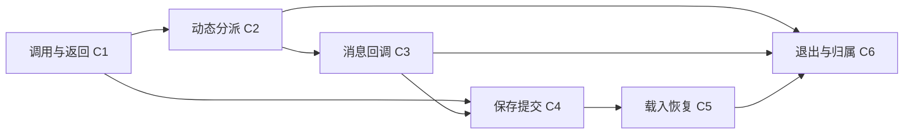

# R1–R3 的具体范围、消费链与工作路径

2026-10-15。依据[固定行动准则](ACTION-GUIDELINES.md)，在[旧代码筛选与迁移报告](legacy-migration-20261015.md)之后，进一步拆解下一轮工作。本文完成的是范围分析；没有修改 Player 源码、添加测试、构建或运行游戏。本轮开始时当前分支为 `my-feature-stable`，已有 P1–P3 迁移及报告提交 `d5939a2b6`。

证据来自当前源码、既有测试的实际检查路径、仓库保留的原版函数摘出，以及旧分支 `8b0d608a775596ba450ba3f78bd62821ff15bd0c` 的具名合同。没有重新固定原版身份、启动新一轮全量逆向、执行原版对照或逐指令验证。本文的“确认差异”指静态路径已经能解释差异，未声称这些路径已在游戏中复现。

## 1. 结论及对上一版范围的更正

R1–R3 应收敛为**六条消费链、24 项结果义务**。其中五处已有具名静态差异；其他项目用于保护现有能力及确认连接，不预设需要修改。实际工作重心是宿主资源暂停与消费者恢复，其次是保存入口的少数语义差异，不能再把三个标题理解成重写参数系统、调度器和存档系统。

上一版 R2 的“同一合法请求执行一次、预算暂停后正确续行”过于笼统，必须更正。执行次数和续行方式取决于暂停原因和执行器类型：

|情况|应保留的行为|不能采用的统一处理|
|---|---|---|
|3019 生成的指令因 busy 返回 false|原 3019 游标保留；下次重新生成参数，表达式副作用可以再次发生|一律缓存第一次求值，或一律禁止重复副作用|
|普通前景/并行事件的脚本 wait、预算耗尽|保留事件帧及下一位置；之后按普通事件轮继续|重新执行已经完成的指令，或重置调用栈|
|3007 等因宿主资源尚未取得而 YieldRepeat|保持这次尚未返回的指令，保留已捕获参数及归属；完成后只提交一次|将资源恢复当成一次新的 3019 求值或新的图片创建|
|消息 hook 遇到脚本 wait、busy 或局部预算耗尽|结束本次 hook 的局部执行片段，读回已产生结果；下次触发从新调用开始|将上次 hook 后缀自动续跑，或自旋到整个公共事件完成|
|消息 hook 因宿主资源等待暂停|暂存同一次调用及尚未提交的窗口消费；资源完成后继续到本次原本的停止条件|提前读回、绘制并销毁执行器，或借此续跑脚本 wait 后的后缀|
|读档、返回标题或对象退役|退出旧调用；新状态拥有后续执行，旧请求不能重新挂接|恢复旧地图的后缀、同号对象或旧窗口回读|

原版消息 runner 的依据是 [1bbfb0](runtime-modes/evidence/0x1401bbfb0-pseudocode.txt)及旧 `instruction-contracts/3029.md`：每次调用重置专用栈，使用独立的局部预算；wait/busy/budget 会停止该次执行。当前 [RunManiacMessageHook](../../../src/game_interpreter.cpp#L6777)的一次局部 `Update()` 对正常停止的思路可保留；问题是宿主资源暂停也被当成了可立即结束的调用。

## 2. 固定纳入的六条消费链

|链|入口与实际路径|本轮负责的结果|明确的边界|
|---|---|---|---|
|C1 调用与返回|1005/12330 → 顺序参数写入 → 子帧 → wait → 12310/END → 接收者 → 清理/刷新|当前、调用者、被调用者 SELF 不串；返回地址按正确时点解析，结果先交付再清理|3036 只核对这条链使用的银行选择、presence、复制与清理；不重审全部数学、数组容量、字符串操作及地图克隆|
|C2 动态分派|3019 → 参数/文本生成 → 同帧 Dispatch → busy 重试或资源恢复 → 原调用者后缀|原生重试与宿主暂停分开；参数副作用、游标和预算正确|以现有变量写入、CallEvent、消息 busy、3007 资源及3002保存这几种消费形态定位连接；不枚举3019能生成的全部指令|
|C3 消息回调|3029 注册 → user/create/destroy/blit 包 → 调用者银行 → hook 局部片段 → 实时回读 → 窗口消费|四类包的银行、顺序、停止点及提交时机正确；同一次资源恢复不丢调用、不重复窗口效果|保留 EasyRPG 字体、字形、输入、打字与窗口实现；只处理直接影响这些包的解析/值读取，不展开全部消息双阶段词法|
|C4 保存提交|普通前景/并行事件或消息 hook 的3002 → 快照 → 文件完成 → 结果/刷新 → 后缀|保存前后结果、命令位置、结果启用标志、SELF归属和last-slot正确|Player自存自读；保留文件系统与错误宿主。原版错误崩溃、文件输出确认UI及跨平台持久化验收不纳入|
|C5 载入恢复|3003/3004及现有读档入口 → Player::LoadSavegame → 银行/图片/窗口 → 地图请求 → SetupFromSave/StartFromSave|旧状态退役，新状态按保存的帧及有效图片状态继续；不重新求值创建指令|同时考虑A3两种现有载入流程的逻辑归属；不复制原版20次显示服务、焦点/F12输入阶段或完整native loader|
|C6 退出与归属|地图转移、Clear/取消、返回标题/新游戏、覆盖/erase/读档 → owner/request退役|应该保留的前景调用及图片继续；被销毁的解释器/窗口/图片不被迟到回调复活|只沿C1–C5及P1–P3现有对象检查；不建设全局任务平台，不改战斗worker或所有场景生命周期|

执行器限于普通地图前景、并行公共事件、并行地图事件，以及消息 hook 的局部公共事件调用。普通 CallEvent 嵌套属于 C1。嵌套触发另一轮消息 hook 的 native 共享栈重入机制尚未闭合，单列未知，不复制旧实现，也不新增“重入直接跳过”的行为。

依赖顺序如下；R1–R3 是责任分类，不是三个彼此独立的重写任务：

## 3. 已有基础及不能重复施工的部分

### C1 的主要语义已经存在

[CallEvent](../../../src/game_interpreter.cpp#L5418)已经按原记录取参数、顺序写入持久的callee银行，再压入子帧；numeric/string/switch参数游标分开。SELF是公共事件或地图定义的持久银行，不是每次调用新建的局部变量表。递归调用同一银行时顺序写入和别名本来就可能影响后面的参数，不能改成通用并行赋值。

[EndEventProcessing](../../../src/game_interpreter.cpp#L2486)已经区分numeric/switch/string接收类型、正/负原始地址及间接模式；负接收者先取得caller环境，来源值从callee读，返回交付之后才执行callee清理。[1005](../../../src/game_interpreter.cpp#L5392)另建无参数/返回负担的新帧，不能套12330的初始化。[3036](../../../src/game_interpreter.cpp#L4910)已有明确的银行选择及刷新分支。

因此，R1不是“重新统一所有读取函数”。共同负引用规则与3019数组base、3036指定银行、12310返回接收者仍需分别保留。短记录缺失0与“字段根本未出现”的区别只在具名消费者核对，不能全仓取消或扩大CmdSetup。

### 普通资源暂停和对象身份已经有支撑

[Update](../../../src/game_interpreter.cpp#L407)已经区分 `Update(true)` 新轮预算与 `Update(false)` 宿主异步续行；YieldRepeat 保留尚未返回的位置及预算。[Game_Map::Update](../../../src/game_map.cpp#L1254)的async context已经指明恢复哪个并行/前景执行器，恢复时跳过之前完成的世界更新。im/pf的分派与页刷新已接入，本轮只核对这些链中的暂停前后位置，不重做运行模式。

P1已有稳定图片/窗口holder、跟随换号的请求绑定及弱JS引用；P3已有3007捕获参数、typed token、等待、取消及对象归属。这些是C2/C3的底座。不能为了修消息hook重新加入槽号即身份、重新Show、GDI或原版线程。

### 保存和恢复骨架也已经存在

[Game_Map::PrepareSave](../../../src/game_map.cpp#L582)收集前景、地图事件和公共事件执行状态；[Scene_Save](../../../src/scene_save.cpp#L100)收集GLOBAL/SELF、随机种子、图片和私有窗口数据。[Player::LoadSavegame](../../../src/player.cpp#L1211)先恢复银行/系统/图片/窗口，再请求地图，恢复保存的执行器。SELF `SetSaveData`是整表替换，不是合并旧地图银行。

P3的kind1私有token快照已避免载入时重复展开插入内容；kind2已有压缩BGRA、尺寸与恢复入口。R3应检查真实载入后这些入口是否接通、后缀是否正确，不能因“有序列化字段”就判定完成，也不预设重写codec。

### 现有检查究竟覆盖到哪里

|既有检查位置|已经有的检查内容|本轮仍需区分的覆盖界限|
|---|---|---|
|[game_interpreter.cpp:3962](../../../tests/game_interpreter.cpp#L3962)|嵌套CallEvent在wait处LSD往返，保存return字段后继续返回|使用直接codec和新解释器SetState；没有走完整Player::LoadSavegame/地图资源/场景恢复|
|[game_interpreter.cpp:5235](../../../tests/game_interpreter.cpp#L5235)|3019同帧分派、参数模式、生成3019跳过及busy重复表达式副作用|没有覆盖3019生成3007后的资源暂停及消息窗口的提交位置|
|[game_interpreter.cpp:3875](../../../tests/game_interpreter.cpp#L3875)|3002非零slot模式、负SELF和invalid-slot结果|没有覆盖启用结果但地址0的即时刷新，或slot16的last-slot规则|
|[game_interpreter.cpp:6335](../../../tests/game_interpreter.cpp#L6335)|返回接收者的native/private保存字段及银行往返|主要检查字段/结果；不能代替保存前后游标、真实载入后后缀及资源归属|
|3750、3777等已有解释器检查|END/marker预算及并行列表重绕|保护现有调度基础；不证明消息hook的宿主资源恢复|
|P1–P3上一轮临时消费者记录|换号/失效、raw/processed像素、文字捕获、延迟XY、取消和私有token保存|证明具名迁移合同；不覆盖本轮六条消费链的所有连接|

上一轮504既有用例和12临时消费者的通过数见[原检查记录](legacy-migration-validation-20261015.json)，本轮没有重跑。检查数量不用于推算兼容率。

## 4. 本轮定位出的五处静态差异

### D1：3019的宿主资源恢复会重新生成参数

[CommandManiacCallCommand](../../../src/game_interpreter.cpp#L8300)每次进入都重新读取code/text并执行参数表达式，然后Dispatch。普通busy返回false时，这与原版合同及现有检查一致。

但是生成3007之后，[文字图片handler](../../../src/game_interpreter_maniac_text_picture.cpp#L13)已捕获参数/typed text，缺资源时YieldRepeat。恢复原3019游标仍先经过整段生成逻辑；旧文字Operation被handler复用，却不能阻止前面的表达式副作用、随机推进或opcode/text重新选择。native3007在这一处是一次尚未返回的同步调用，宿主资源恢复不能变成第二次native3019调用。

**有限修正方向：**仅为已发生宿主暂停的生成命令保留本次物化结果/返回路径，恢复时直接回到它；busy=false仍放弃本次物化结果并允许重新生成。状态跟随当前解释器及原3019位置，Clear/替换时取消。不得为3019全部目标构造第二个解释器或另一套opcode执行器。

### D2：消息hook的局部执行器提前销毁，窗口提前消费

[RunManiacMessageHook](../../../src/game_interpreter.cpp#L6777)在栈上建立局部解释器，一次Update后立即析构。[解释器析构](../../../src/game_interpreter.cpp#L111)会Cancel尚未完成的文字Operation。若hook包含3007且资源pending，操作因此失去完成回调，窗口仍留有取消的Operation。

同时，create/destroy/user/blit的[Window_Message消费者](../../../src/window_message.cpp#L368)立即读回/关闭/绘制；[Game_Map::UpdateMessage](../../../src/game_map.cpp#L1394)的既有async规则明确“消息内部不支持暂停，恢复时跳过消息阶段”。所以只延长hook执行器寿命还不够，必须接回窗口消费。

**有限修正方向：**由这次消息消费持有局部hook及未提交阶段，宿主资源完成后继续同一片段，然后实时读回当前base并提交一次。分别接create初始化、destroy关闭、user E位置和blit glyph绘制；普通脚本wait/busy/budget结束仍读回并丢弃hook后缀。载入、关闭或替换消息时取消未提交阶段，不能保存指向旧窗口/字形的裸回调。

这允许局部的窗口阶段状态，不要求复制native专用共享栈、message pump或battle worker。不能把正常wait后缀不执行当成另一个bug修掉。

### D3：E参数禁用时仍取根值，且没有按数字/字符串银行分别抑制

[ProcessManiacUserHook](../../../src/game_message.cpp#L415)使用默认 `evaluate=true` 的UserHookParser，先MixedToken读取V/T/N根值，随后才根据enabled及对应base决定是否写入。旧3029合同明确：关闭hook或对应base=0时仍解析并求嵌套ID，但抑制该输出类别的根取值/赋值。

**有限修正方向：**区分“解析/嵌套ID求值”和“根值求取/提交”，且数字、字符串根分别按各自的base启用。不能把整个递归parser设为evaluate=false。只改这条E参数消费路径；不全局静音变量告警，不改字体、文本输入或全部转义规则。

当前实现额外读取无效actor根值时可以进入ActorName错误路径。这解释一种可能的额外报错机制，但本轮未读取新的游戏日志或复现，不能将它认定为此前黄字的唯一原因。

### D4：3002“启用结果但地址0”丢失即时刷新

原版 [24f10](evidence/0x140024f10-pseudocode.txt)在raw count>2且A2!=0时进入结果分支，即使缺A3或A3=0仍执行im即时事件页刷新。当前 [CommandManiacSave](../../../src/game_interpreter.cpp#L6155)把A2归一到out_var，只保留地址；out_var=0与禁用结果无法区分，handler及[Scene_Map保存消费](../../../src/scene_map.cpp#L457)均只在非零写回成功时刷新。

**有限修正方向：**在这条保存请求保留独立的result-enabled事实，结果地址0仍不写变量，但在正确时点调用已有im/pf刷新接口。正常slot及invalid slot、普通异步与hook同步都消费同一事实。不得改成每条保存无条件刷新，也不把缺字段补齐后的0当成未出现字段。

### D5：slot16及以上被写入last-slot

同一原版24f10只在slot1..15更新last-slot，slot16及以上仍合法保存并增加保存计数。当前 [Scene_Save](../../../src/scene_save.cpp#L132)无条件 `SetSaveSlot(slot_id)`，而[setter](../../../src/game_system.h#L622)直接赋值。因此3002保存slot16会改变脚本可观察的last-slot；这不是LSD字节比较问题。

**有限修正方向：**将3002的文件slot与本次last-slot规则分别消费，保留已有普通保存UI的行为；在收集快照前确定元数据，保存计数只增一次。错误流的native堆/崩溃及宿主持久化不在本轮，但合法slot的状态不能因为缩小范围而忽略。

## 5. 两项可以明确排除的不必要建设

### 不新增“消息hook全状态存档”

原版根保存函数 [81c90](evidence/0x140081c90-pseudocode.txt)的0x71明确把固定 `&DAT_14026cad0` 交给执行状态serializer；hook runner切换的活动指针是 `DAT_14026d2d8`，专用栈是 `DAT_14027a530`。保存入口没有因活动指针切换就把hook栈替换成前景栈。0x72另收集固定公共事件对象中的执行状态。

因此，不能从“hook里面发生3002”推出“必须把hook全部帧、预算和后缀塞进Player私有存档”。当前PrepareSave收集普通前景/并行状态的方向可保留，C4只核对真实保存时普通执行器的位置及结果顺序。旧3002合同关于active-frame快照的建议必须按这个根选择收窄，不直接照搬旧同步保存实现。

### 不预先序列化所有pending Operation

[Operation::Start](../../../src/maniac_text_picture.cpp#L412)把资源设为important；[Scene::MainFunction](../../../src/scene.cpp#L147)在重要资源pending时只运行 `Player::Update(false)`。普通地图解释器、其他并行事件及保存菜单逻辑因此不会继续执行；产生YieldRepeat的解释器也停止在该指令。

在这条正常调度路径上，不能凭“Operation不在LSD”就认定存档缺字段。先确认保存点是否可达。当前C4应覆盖资源取得前尚未启动操作的保存点、取得完成后的保存点，以及普通脚本wait处的保存；R3优先恢复有效状态与正常执行帧。

若限定消费链内发现确实可达的重入保存/载入，再单独确认其快照边界，补最少信息。直接调用Scene_Save的测试能力、外部C++保留对象或宿主回调本身，不等于合法游戏脚本的保存点。不要为不可达状态建设通用continuation codec。

## 6. 24项结果义务及关闭方式

这些是合同分支和消费者结果，不是24条永久测试，也不是逐opcode验收。已有能力允许以源码依据及对应既有检查保护；修改的链须接到真实消费者，并在授权范围内补任务内临时非UI检查。

|义务|必须得到的可观察结果|当前判定/下一步|
|---|---|---|
|C1-01 短记录/presence|调用/返回缺字段与显式0、null与present-empty按具名分支区别消费|主要已有；保护原count门槛，不全局规范化|
|C1-02 参数/别名|来源在caller；按顺序写callee，分类游标独立，同银行别名保持顺序|已有实现和检查；核对实际调用链，不重写银行|
|C1-03 返回接收者|地址延迟至返回，正/负及indirect采用指定银行和求值顺序|主要已有；在wait及载入后实际消费|
|C1-04 返回/清理|先交付，再callee清理及事件刷新；END不伪造返回负担|主要已有；保护异常早退/正常返回分支|
|C1-05 SELF身份|common与map-definition银行保持身份；地图转移不把保留前景帧SELF改成新图|已有字段；接C6的真实生命周期|
|C2-01 物化规则|原3019同帧，direct/indirect/SELF/text及name-cache仍按现有合同|已有；不增加虚构保存帧|
|C2-02 busy重试|重新物化及必要的再次副作用，原位置未消费|已有针对检查；作为D1修复的反向保护|
|C2-03 资源恢复|已物化code/text/参数和副作用不重做，图形提交一次|D1；补当前解释器的局部恢复连接|
|C2-04 游标/预算|恢复同一轮，未完成指令不多扣预算；im/pf返回尾保持|依赖现有Update(false)/Dispatch；检查暂停前后位置|
|C3-01 参数包/回读|packet写caller银行，hook执行用common银行；string/numeric顺序、presence与live base回读正确|基础已有；随D2四个实际消费者共同核对|
|C3-02 E根值门控|禁用数字/字符串根按各自base抑制，嵌套ID仍求值，末项仍赋值|D3；定向解析消费修正|
|C3-03 正常停止|脚本wait/busy/budget终止本次hook；下一次新调用，无自动旧后缀|原版证据明确；保护当前局部片段思路|
|C3-04 资源后提交|create/user/destroy/blit暂停后各完成一次真实回读和窗口效果|D2；不能只让handler恢复而跳过窗口|
|C3-05 取消|消息被载入/关闭/替换后，迟到请求不回写旧packet或绘制旧glyph|随D2及C6检查；仅持有当前消费所需状态|
|C4-01 结果启用/归属|地址0保留刷新；正GLOBAL/负caller SELF；invalid-slot也遵守启用条件|D4；已有identity/result基础可复用|
|C4-02 快照时点|文件内保留写回前结果；已完成的普通保存指令从后缀恢复，不重复保存|普通async路径已有推进；检查实际快照与恢复链|
|C4-03 元数据|slot1..15更新last-slot，slot16+不更新；计数只增一次并进入本次文件|D5；文件slot与状态slot分别消费|
|C4-04 执行状态选择|保存普通前景及相关并行状态；hook3002不引入hook后缀持久化|原版根选择已确认；保留当前收集骨架|
|C5-01 银行/帧恢复|载入替换旧SELF表，restore caller/callee/return/wait及GLOBAL presence|字段及直接codec检查已有；走实际load提交路径|
|C5-02 图片有效状态|kind1不重解释变量/转义，kind2保留尺寸及alpha0RGB；资源重建后接像素查询/更新|P1–P3基础已有；核对真实载入后的消费者与target继续|
|C5-03 新状态续行|地图资源未完成不提前启动；A3两路径不续旧地图后缀；普通wait处随后返回正确receiver|当前load continuation已有；联合C1/C6检查|
|C6-01 地图边界|保留的前景调用/图片继续；旧map并行及按flag擦除图片退出|已有OnMapChange/Dispose；不得全清所有SELF及图片|
|C6-02 Clear/标题/新游戏|解释器及局部hook请求取消；新游戏按现有ResetGameObjects重建银行/JS/图片/窗口|已有Cleanup/P3；接D1/D2新增局部状态的清理|
|C6-03 迟到/同号对象|旧图片/窗口/JS弱引用不能访问新同号对象；换号仍跟随同一个活对象|P1基础已有；与实际load替换一起核对|

C5-02不要求把所有renderer缓存原样序列化。raw/processed时机继续遵守P2；只核对载入正常重建边界和首次消费者，不为了历史缓存相等新增原版不存在的持久化门槛。

## 7. 具体工程路径及允许触及的代码

|阶段|完成内容|主变更位置|交付及停止条件|
|---|---|---|---|
|W1 参数/保存入口|保护C1，先修D3/D4/D5，确定packet及save元数据的字段责任|game_message.cpp、game_interpreter.cpp、async_op.h、scene_map.cpp、scene_save.cpp；必要声明/保存结果helper|R1及C4具名差异关闭；普通UI保存及已有调用返回检查不回退。不扩至全部bank/codec|
|W2 同帧生成命令恢复|修D1，区分busy与资源暂停，接Clear/替换取消|game_interpreter.cpp/.h，现有3007 Operation连接；需要时局部源文件|C2四项关闭；没有新frame/重复表达式，busy规则仍成立。不重分派所有opcode|
|W3 消息消费恢复|修D2，接四类窗口消费，保留局部预算/脚本停止合同|game_message.cpp/.h、window_message.cpp/.h、RunManiacMessageHook、Game_Map::UpdateMessage及现有async context的必要接口|C3五项关闭；各次消费从正确阶段提交，取消有效。若需要整套native消息/战斗驱动则停止该方案|
|W4 自存自读与退出|检查真实save/load/new-game/map-change链，将W2/W3新增局部状态纳入已有退役点；只有证据确认缺字段才补|player.cpp、game_map.cpp、game_interpreter_map.cpp、game_pictures.cpp、game_windows.cpp、main_data.cpp及现有私有字段消费者|C4–C6关闭，旧owner和后缀不侵入新状态；不以同进程codec往返代替载入后的执行|
|W5 收尾|相关既有非UI集合、必要临时消费者检查、构建清单及报告分别整理|现有runner及Windows构建wrapper；临时检查不永久留存|检查有完整汇总，记录实际消费路径；代码与报告分开提交，留下干净工作区|

阶段代码位置是允许评估的连接点，不表示必须修改每个文件。W1已经共享C4的入口责任，不能再在R3重复实现另一套save handler；W2为W3提供正确的宿主暂停分类，不能各自造一套统一重试框架。

W3所需状态的边界是“本次消息消费”：caller身份、局部hook帧及预算、packet/待消费token和阶段、有效owner与取消。GLOBAL/SELF本身仍在原管理器；不复制银行、不把整个窗口/Scene/Font系统装入可序列化事务对象。create/user/destroy/blit必须有各自的提交位置，不能用“下一帧重跑Window_Message::Update全部内容”冒充恢复。

消息hook产生load/title等控制转换时，场景消费者仍拥有新状态；该hook不能因为新增资源恢复而跨状态转换保留旧后缀。普通新地图也不能把前景SELF的地图身份随便改为目的地图；它与旧并行map执行器被销毁是不同边界。

## 8. 预算、预期效果及未知项

### 对5–12人日估计的修订

|责任|现有支撑与具体工作|开发/非UI检查估计|
|---|---|---|
|R1及保存入口|C1以保护和连接核对为主；D3/D4/D5为局部差异|1–2人日|
|R2|D1动态资源恢复、D2消息hook及四类窗口提交、预算/取消联接|3–6人日|
|R3|C4–C6真实自存自读/归属核对，接新增状态清理，按确认缺口补最小连接|1–3人日|
|合计|前三项5–11人日，至多再留约1人日用于联合收尾及文档|**5–12人日，仍是工程估计，置信度中低**|

这些是人工工程时间，包含定位后的实现、构建与有限非UI检查；不是运行时长、token预算或日历交付承诺。新估计把主要成本放到实际需要适配的R2，降低了把R3理解成native存档移植的风险。五处静态差异已有具体路径，因而比上一版三个泛标题更能估价；但消息恢复的实际接口规模仍需开发中验证，不能提高到高置信度。

估计假设：沿既有async/holder/codec能接通这六条链，不发现必须另做原版消息重入机制、战斗驱动或新平台宿主。若接口连通失败，先指出是哪条义务及哪个缺失连接，再重估该项；超过预算边界时留下可交付包及恢复点，不能用继续扩大范围掩盖原估计失效。

### 会得到的效果

这轮针对共享执行边界：动态文字生成不因等待重复改变变量/随机状态；消息回调可以等待合法资源而保留显示、位置和颜色结果；被禁用的参数输出不额外读取根对象；合法保存保持正确的结果刷新和last-slot；读档后返回接收者、图片与新对象继续匹配。它们不依赖弹珠游戏名称，也不只修一个截图。

这仍不是“所有Maniac游戏无差异”的保证。旧报告四个系统性原因在本轮的责任落到：C1/C2/C3/C4的入口语义，C2/C3的实际消费者，C3/C5/C6的归属生命周期，以及各链的证据与检查覆盖。四类原因在这六条链中可以结项；其余Map/MoveRoute、Pack、SaveInfo、媒体、JS完整语义及战斗行动效果不因此自动关闭。

### 保留但不扩入的未知

|未知/范围外对象|本轮处置|为什么不阻塞具名改造|
|---|---|---|
|MSG-REENTRY-FLOW：嵌套触发新的消息hook、共享native栈重置与异常恢复|旧证据保留；若在本轮正常消费链中出现必要依赖，先分类该分支，不默认重入跳过或每层独立完成|当前D1–D5有可独立说明的差异；完整重入尚无可信收尾预算|
|资源pending期间的重入存档|正常调度路径已证明会阻塞；只有具名可达路径才考虑额外状态|不能因C++可直接调用保存就建设全异步状态codec|
|战斗3009/3010/3037及旧G1–G4|保持独立行动效果/目标身份候选，旧未知与已确认现象分开|不复制旧battle pump；这轮不能声称关闭其行动效果|
|额外指令、容量/CRT/正则/JS、全消息词法|按明确需求建立下一个包|本轮只触及具名消费链中的必要分支，不从一个helper追全部调用者|
|原版存档双向互通、LSD字节相等、Web/Android持久化与UI|保持行动准则中的独立边界|不拿静态/Windows构建或字段往返推定平台和真实游玩已通过|

## 9. 本轮完成及下一轮终态

本轮已完成更深的范围分析：六条链及24项义务具名；已有实现、五处静态差异和未知项分开；工作顺序、变更连接、预算假设与拒绝扩展条件明确。Player产品源码未修改，本轮没有新增运行验收结论。

下一轮的终态是完成**这24项限定义务**，代码/报告分别提交，已有检查不回退，新增临时检查移除，并注明未执行的原版/实际游戏/UI/平台验收。必要义务若仍未知，则标出未完成的具体包，不因其余检查绿色而整体宣称完成。连续两个检查点没有新增可观察证据，停止该未明问题并保留恢复点；不重开168指令/851矩阵或全原版驱动工程。
