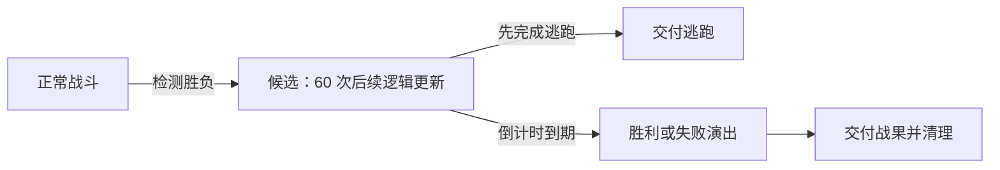

# SDW 两轮问题的根因复查与战果阶段修正

2026-11-06 至 07。基线为 `6bca17163`（2026.11.3），即前两轮修复完成后的版本。对应此前的[战斗等待与防御报告](sdw-atb-defense-20261106.md)和[自动帐篷报告](sdw-auto-tent-20261106.md)。

## 复查结论

这些问题不是同一个根因，不能用一套大范围重构代替各自的行为合同。

| 前两轮发现 | 根因所在 | 本轮判断 |
|---|---|---|
| 缺省等待模式被读成主动模式 | LSD 缺省值与原版初始化不一致；写出时还必须保留显式 0 | 已在读写入口修复，保留 |
| 5003 在战斗中失效 | 通用指令只分派给了地图解释器 | 已移到共享分派，保留 |
| Maniac 槽值增长过快 | 识别为英文引擎后，错误套用普通英文版的低槽倍率 | 已在共享 ATB 算法处区分，保留普通引擎分支 |
| 确认输入被吞 | 把原版重新查询输入，直接映射成 EasyRPG 推进输入逻辑帧 | 已删除收栈中的额外 `Input::Update()`，保留 |
| 防御动画重头播放 | 状态通知被误当作新的动作请求，重复创建同一待机动画 | 已使待机姿势更新保持幂等，保留显式动作的重新播放能力 |
| 自动帐篷不触发 | 过早进入 Victory/Defeat 后停止战斗并行事件 | 之前恢复并行事件解决了道具，但结算阶段仍不完整 |
| 名义 60 帧等待实际在同帧耗尽 | 把同帧续行返回值用于倒计时 | 之前让计时跨帧，但等待所处的状态仍不正确 |

本轮实测发现，**“允许结算期间继续运行公共事件”仍不等于实现原版的战果候选阶段**。旧版在检测到全灭时已经锁进 Victory/Defeat，所以后续公共事件虽然能执行，逃跑请求仍被终局状态拒绝。

同时，解释器的 `main_flag` 混合了地图前台等待规则、战斗主事件角色及基础栈生命周期。战果消息不是主战斗事件自己的消息，却会阻塞它；敌人全灭后的检查又放在执行指令之后、自动推进游标之前，可能在继续执行时重放刚执行过的指令。

## 本次修正的合同

复用已有逃跑候选的字段，推广为 Maniac 胜负候选，不增加独立的 SDW 特例。

- 候选期间保留当前场景状态，暂停 ATB、主战斗解释器和新敌群页调度；独立战斗公共事件继续运行。
- 候选到期才进入 Victory/Defeat。到期处理先于同帧的逃跑完成，所以截止点重合时，已成立的胜负候选先交付。
- 已记录的胜负不因随后回血或复活敌人而重新选择；合资格的逃跑若提前完成，仍能先交付。中断战斗停止后续副作用。
- 胜负演出期间恢复已有主事件，主事件按原版 mode 2 的敌人存活条件决定能否派发下一条指令。独立回调和并行事件不使用这个门。
- mode 2 在派发前检查敌人存活；已执行的指令正常推进游标。地图和普通引擎继续使用原分支。
- mode 2 只等待它自己的消息，不套用地图前台对所有待处理消息、上下船和车辆升降的等待规则。战果提示不再冻结其等待计数。
- 新选中的 Maniac 敌群页在本逻辑帧开始执行；不为交接再推进一次输入、UI、ATB 或逻辑帧。
- 场景状态机同帧续行时，刚设置的等待从下一次更新才开始扣除；不再使正常逃跑提前一帧。
- 无队员与全队死亡分别处理：原版在队伍为空时立即交付逃跑，不进入败北候选。
- 已经过候选等待的胜负不再在展示状态重复等待 60 帧。原有直接进入展示状态的分支保留其等待。

代码只涉及 `src/scene_battle_rpg2k3.cpp/.h` 和 `src/game_interpreter.cpp`。没有硬编码游戏事件号或变量号，没有新增产品提示文字，也没有替换字体、输入、窗口、音视频或宿主接口。

## 原版依据

本轮运行 SDW 自带 `RPG_RT.exe`。新的机器码定位与只读进程采样确认：

- `140188BE5` / `140188C4A` 向 RVA `275144` 写入 60；败北和胜利候选标志位于 RVA `2751DD` / `2751DE`。
- 例如敌人于事件时钟 30 全灭，下一次采样可见时钟 31、计时 59。不是先进入战果演出再补 60 帧。
- 复用的 250921 English 静态证据中，`14018C080` 选择候选，`140188680` 先消费已有候选，`14008A040` 在 mode 2 派发下一条指令前检查存活敌人，`140045660` 在指令调用前推进原版游标。

后四个地址属于既有 English 审计，不能冒充 SDW 文件的地址；本次 SDW 游戏对照、变量和存档回读独立验证可观察合同。保留 EasyRPG 的宿主实现，不复制原版内部线程和调用栈布局。

## 19 个构造场景的实机对照

使用独立数据副本，保留 SDW 的角色、敌群、资源和可被原版加载的存档结构，替换为受控事件；所有结果写入副本的检查点。另以原游戏逻辑做回归，二者不混为一种证据。

表中“中断”表示没有进入胜利、逃跑、败北分支，并且中断后的标记未执行；夹具使用 99 表示这种未进入分支的状态，99 不是引擎战果枚举。

| 编号与触发 | 原版 | 旧版 6bca17163 | 修正版 |
|---|---|---|---|
| 1 普通敌人全灭 | 胜利 | 胜利 | 胜利 |
| 2 时钟 30 全灭，40 请求逃跑 | 逃跑，70 完成 | 胜利 | 逃跑，70 完成 |
| 3 全队死亡 | 败北 | 败北 | 败北 |
| 4 败北候选后全恢复 | 仍败北 | 仍败北 | 仍败北 |
| 5 存活时强制逃跑 | 60 完成 | 59 完成 | 60 完成 |
| 6 胜利候选后复活敌人 | 仍胜利 | 仍胜利 | 仍胜利 |
| 7 普通战斗中断 | 中断，后续标记 0 | 相同 | 相同 |
| 8 候选到期后再请求逃跑 | 仍胜利 | 仍胜利 | 仍胜利 |
| 9 敌我同时全灭 | 败北优先 | 败北优先 | 败北优先 |
| 10 菜单等待后在 200 请求逃跑 | 230 完成 | 229 完成 | 230 完成 |
| 11 全灭后在 59 请求逃跑 | 89 完成逃跑 | 胜利 | 89 完成逃跑 |
| 12 全灭后在 60 请求逃跑 | 到期胜利优先 | 胜利 | 到期胜利优先 |
| 13 全灭后在 61 请求逃跑 | 胜利 | 胜利 | 胜利 |
| 14 全灭后逃跑，并行调用中再等待 70 帧 | 提前逃跑，等待后的标记 0 | 胜利，标记 1 | 提前逃跑，标记 0 |
| 15 败北候选期间恢复队伍，再请求逃跑 | 80 完成逃跑 | 败北 | 80 完成逃跑 |
| 16 胜利候选期间中断战斗 | 中断，后续标记 0 | 相同 | 相同 |
| 17 移除全部队员 | 30 立即交付逃跑 | 败北 | 30 立即交付逃跑 |
| 18 主敌群页致胜，候选期间敌人复活 | 胜利，随后标记 1 | 胜利，标记 0 | 胜利，标记 1 |
| 19 主敌群页等待跨越败北候选和战果提示 | 败北，主事件恢复队伍，标记 1 | 败北，主事件停住，标记 0 | 败北，主事件恢复队伍，标记 1 |

共确认并修正 **7 个结果或副作用差异**，另有 5、10 两例的一帧提前完成问题。其余构造为既有行为的控制组。

19 中，原版主事件在时钟 20 开始，160 完成，差值 140 = 80 帧指令等待 + 60 次候选暂停。修正版的开始、完成时钟均与原版相同。旧版的主事件没有完成。14 中，原版与修正版都在独立时钟 70 退出，受等待阻塞的事件自身时钟仍为 40，证明不是恢复了不该执行的等待后代码。

胜负消息的确认时间依赖输入、字形及显示过程，不用整个战斗的总时长替代上述逻辑时钟、截止点、战果、数值和副作用比较。

## 原游戏逻辑回归

在另一个副本中完整保留 SDW 原公共事件、敌群事件和资源，只追加独立观察事件。用真实 W 按住/释放和实际选择「ガード」，回读游戏自己写出的观察存档。

- 原版、旧版、修正版都在等待菜单中保持敌槽不变；按住 W 后模式变为主动、槽值增长；松开后恢复等待并保持槽值。
- 旧版与修正版的八组观察值逐项相同：模式、两敌槽值百分比和防御标志均一致。两边都是等待时 69、69；主动时 82、96；松开后 96、96；后两次观察的防御标志均为 1。
- 原版相应槽值为 70、70、83、96、97、97，模式和防御标志相同。前轮已记录的进场槽初值差和百分比量化仍存在，没有将这些观察夸大为全战斗逐帧或像素等价。

SDL 输入实测使用正确扫描码，并切换到游戏窗口的英文输入状态；仅发送按键而未读到实际模式改变的尝试不算通过。不为绕开 IME 修改产品输入实现。

自动帐篷的三个实际战斗回归均与原版的库存和全队 HP/SP 相同：开启时库存 5→4，全队恢复；关闭时库存仍为 5，全队 HP 仍为 100；空库存时仍为 0，全队 HP 仍为 100。三个分支均未更改原游戏事件。完整回读和最终交付检查记录在本地 `validation.json`。

## 构建、检查与边界

按项目 Windows 脚本和 ASCII 构建目录构建 Release Player / test runner；使用 in-tree 兼容 liblcf。临时消费者检查通过 10 项 / 107 条断言，包含前轮默认值、显式 0 往返、共享 5003、输入帧、线性 ATB、防御动画、普通引擎分支，以及 mode 2 的派发前检查和不重放致胜指令。

移除临时测试后，正式 runner 的相关集合：BattleAlgorithm 56 项 / 3290 条断言，Game_Interpreter 85 项 / 1889 条断言，Maniac 90 项 / 1934 条断言，`*battle*` 4 项 / 111 条断言。集合有交集，不相加为独立总数。

既有 `Maniac 250921 save resolves nonzero slot modes and invalid-slot results` 会提前结束整个 runner，本次显式排除，不将退出码 0 当作它通过的证据。Release 元数据校验和差异检查通过。按用户后续要求将版本号从 2026.11.3 提升至 2026.11.4，`RELEASE.md` 仅修改标题中的版本号，原更新说明逐字保留。

证据位于本地忽略目录 `build/sdw-root-audit-20261106/`：夹具生成脚本、原版采样、旧版及修正版检查点、原游戏回归存档、临时消费者和日志。早期夹具缺少启动地图/读档回调、错误使用负敌人编号、未正确关闭整个开关范围，以及未到达 SDL 的输入尝试，均已纠正或排除，不作为成功证据。

本轮完成条件限于该行为包、上述控制组和 Windows 实机回归。不声称完整 Maniac 移植、所有游戏或其他平台已验收，也没有更改普通引擎的等待与分派分支来追求全局形式统一。
